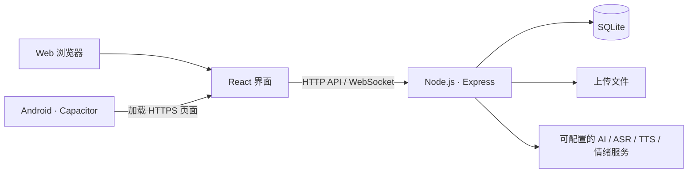

# Kinloop · 银龄心语

面向长辈与家属的家庭沟通与陪伴应用。Kinloop 将日常聊天、语音交互、家庭回忆和关怀提醒放在同一个空间，让长辈更方便地表达，也帮助家属持续了解与回应。

项目包含 **React Web 前端、Node.js 服务端与 Capacitor Android 工程**。当前 Android 分支采用远程网页壳模式：安装包加载线上页面，业务数据与 AI 能力由独立后端提供。

[下载 Android 测试包](https://github.com/ZYHTZZF/kinloop/releases/latest) · [查看版本记录](https://github.com/ZYHTZZF/kinloop/releases) · [本地运行](#本地运行) · [Android 构建](#android-构建)

## 核心功能

| 模块 | 主要内容 |
|---|---|
| 家庭与角色 | 长辈端、家属端及照护角色；账号登录、家庭空间、邀请码加入与成员管理 |
| 日常沟通 | 单聊、家庭会话、文字／图片／语音消息、未读状态与 WebSocket 消息通知 |
| AI 沟通辅助 | AI 伴聊、语音意图理解、发送前建议、代际表达转换与未读消息摘要 |
| 语音交互 | 语音识别、语音播报；Android 工程包含本地唤醒词与原生语音桥接 |
| 音视频交流 | 基于 WebRTC 的语音／视频通话与相关权限适配 |
| 状态与关怀 | 情绪趋势、每日状态、关怀提醒与跟进记录；文本、语音和表情分析通过适配器接入 |
| 家庭内容 | 心语墙、图片动态、点赞评论、家庭回忆与回忆触发 |
| 协作与提醒 | 家庭协作、重要日期及自定义事件提醒 |

AI、ASR、TTS、邮件及部分情绪分析需要配置对应服务。客户端在部分网络异常情况下会回退到演示数据，情绪适配器也包含模拟实现；页面能展示内容，不代表真实模型、真实消息投递或真实分析已经成功。

## 使用入口

- **长辈端**：首页、联系人、会话、心语墙和求助入口，主要路由为 `/elder/*`。
- **家属端**：今日概览、状态趋势、聊天、心语墙、回忆和家庭协作，主要路由为 `/family/*`。
- **首次使用**：从 `/welcome` 进入引导。家属配置账号与家庭，长辈通过邀请码加入；账号验证邮件依赖服务端 SMTP 配置。

### Android 下载说明

推荐使用 [v0.2.0-android-dev-apk](https://github.com/ZYHTZZF/kinloop/releases/tag/v0.2.0-android-dev-apk) 中的 `app-debug.apk`。

- 这是 **Android 测试安装包**，不是应用商店正式发行包。安装时可能需要允许对应来源安装应用。
- APK 为远程网页壳，完整业务依赖网络与线上服务；更新网页通常不需要重装，原生插件、权限或壳配置变更仍需要重新打包。
- 仓库当前 Android 工程配置为 `arm64-v8a`、最低 SDK 24；请使用兼容设备，摄像头、麦克风等功能需授权。
- Release 中的 APK 来自源项目历史成品同步，保留原文件与 SHA-256，**不是用本次 README 更新重新编译的 APK**。源码压缩包对应 Release 标签指向的脱敏提交。

## 技术与结构

| 层次 | 技术 |
|---|---|
| Web 界面 | React 19、TypeScript 5.9、Vite 8、React Router 7 |
| 服务端 | Node.js、Express 5、WebSocket（`ws`） |
| 数据 | Node 内置 SQLite、上传文件目录 |
| Android | Capacitor 8、Java／Kotlin、原生权限与语音插件 |
| 可选能力 | MediaPipe、Sherpa-ONNX 本地唤醒、火山／腾讯语音及其他模型服务适配 |



```text
src/
  app/             路由、角色守卫与布局
  pages/           长辈端、家属端及引导页面
  components/      聊天、通话与公共界面组件
  services/        API、实时通信与 WebRTC
  platform/        地址、权限、通知与语音适配
  domain/          业务内容、提示与领域规则
server/
  db/              SQLite 结构与初始化
  repositories/    家庭、会话、回忆、提醒等数据操作
  routes/          AI、语音、摘要等接口
  services/        模型适配、情绪分析与认证服务
android/           Android 原生工程与本地唤醒资源
public/            静态资源、离线提示页及视觉模型资源
docs/              产品、技术与部署材料
scripts/           开发检查和评估脚本
```

## 本地运行

建议本地使用 **Node.js 24 LTS 与 npm**。服务端使用 `node:sqlite`，不要使用缺少此模块的旧版 Node。Dockerfile 当前使用 Node 22 镜像，与本地推荐版本分别管理。

### 1. 获取代码与安装依赖

```bash
git clone https://github.com/ZYHTZZF/kinloop.git
cd kinloop
npm ci
```

### 2. 首次创建本机配置

Windows PowerShell：

```powershell
Copy-Item .env.example .env.local
```

macOS／Linux：

```bash
cp .env.example .env.local
```

若已有 `.env.local`，保留原文件并按需补充。示例中的 `your_...` 都是占位符：只填写准备使用的服务，其余密钥字段清空；占位符不能用来请求真实服务。后端读取 `.env.local`／`.env`，已有的进程环境变量优先。

### 3. 分别启动后端和前端

终端一：

```bash
npm run dev:api
```

终端二：

```bash
npm run dev:web
```

打开 Vite 输出的地址，默认是 `http://localhost:5173`。后端默认端口为 `8787`，Vite 将 `/api` 代理到本机后端。可以访问 `http://127.0.0.1:8787/api/health` 检查后端进程是否启动；健康检查成功不代表外部 AI、邮件或语音服务已验证。

SQLite 与上传目录首次使用时初始化，默认位于 `data/`。该目录属于运行数据，请另行备份，不提交到 Git。

## 环境配置

完整字段示例见 [.env.example](.env.example)，服务端实际读取规则见 [server/config.mjs](server/config.mjs)。

| 配置组 | 常用变量 | 用途 |
|---|---|---|
| 后端监听 | `KINLOOP_API_HOST`、`KINLOOP_API_PORT`／`PORT` | 本地或部署环境的监听地址与端口 |
| 持久化 | `KINLOOP_DATA_DIR`、`KINLOOP_DB_PATH`、`KINLOOP_UPLOADS_DIR` | 数据库与上传资料位置 |
| 静态资源 | `KINLOOP_CLIENT_DIST_DIR` | 后端托管的前端构建目录，默认 `dist` |
| 模型服务 | `KINLOOP_LLM_BASE_URL`、`KINLOOP_LLM_MODEL`、`KINLOOP_LLM_API_KEY` | 服务端模型配置 |
| 语音 | `KINLOOP_ASR_*`、`KINLOOP_VOLC_*`、`KINLOOP_TENCENT_*` | 按所用供应商配置识别与播报 |
| 情绪分析 | `KINLOOP_EMOTION_*`、`HUME_*` | 按适配器选择对应提供方 |
| 邮件与账号 | `KINLOOP_SMTP_*`、`KINLOOP_AUTH_*` | 注册邮件、会话与验证码策略 |
| Android 页面 | `KINLOOP_APP_URL` | 远程壳加载的 HTTPS 页面地址 |
| 打包资源模式 | `VITE_API_BASE_URL`、`VITE_WS_BASE_URL`、`VITE_API_BASE_PATH` | 本地资源模式下的原生 API 地址适配；当前远程壳优先使用页面同源地址 |

真实密钥、SMTP 口令和认证令牌只放本机或部署平台的环境配置中。**不要把服务密钥填写到 `VITE_*` 变量中**：这些变量可能进入浏览器和 APK 的前端产物。示例中保留的历史 `VITE_VOLCANO_API_KEY` 字段不应填入真实凭证；相关旧调用链需先核对服务端代理与授权方式。

## Android 构建

当前 [capacitor.config.ts](capacitor.config.ts) 默认加载维护者配置的远程 HTTPS 页面，页面不可用时显示 `offline.html`。如果部署自己的后端与网页，应修改壳的页面地址，而不是将手机的 `127.0.0.1` 当作电脑或服务器地址。

准备 **JDK 21、Android SDK 36、Android Studio**，然后在 PowerShell 中执行：

```powershell
$env:KINLOOP_APP_URL = 'https://your-kinloop.example.com'
npm run build:android
npm run android:open
```

也可以使用 Gradle 生成 Debug 包：

```powershell
cd android
.\gradlew.bat assembleDebug
```

通常输出到 `android/app/build/outputs/apk/debug/app-debug.apk`。macOS／Linux 使用 `./gradlew assembleDebug`。JDK、SDK、ABI 以当前 Gradle 文件为准；旧迁移材料中的 JDK 17／HTTP 开发说明不代表本分支当前配置，当前壳默认禁止明文流量。

`npm run build:android` 构建 Web 资源并执行 Capacitor 同步，**不会单独完成 Gradle APK 打包**。由于当前采用远程壳，打入本地的页面也不会自动替代 `server.url` 指定的线上页面。

## 部署与持久化

仓库根目录 [Dockerfile](Dockerfile) 会构建前端，并启动提供静态页面与 API 的 Node 服务。Railway 的操作步骤见 [部署指南](docs/railway-deploy-guide.md)。

- 数据库与上传资料需要持久化卷，容器默认使用 `/data`；只保留容器临时磁盘不能保证数据保留。
- 平台提供的 `PORT` 优先于 `KINLOOP_API_PORT`，对外服务需正确设置监听地址。
- 远程 Android 壳应使用可访问的 HTTPS 页面；WebSocket、相机、麦克风、语音与通知还需在目标设备上逐项验证。
- `KINLOOP_AUTH_DEV_EXPOSE_CODES` 仅用于隔离的开发环境，公开部署保持关闭。CORS、账号、AI 和邮件配置应按实际部署环境核对。

## 常用命令

| 命令 | 作用 |
|---|---|
| `npm run dev:web` | 启动 Web 开发服务器 |
| `npm run dev:api` | 启动 Node API 与 WebSocket 服务 |
| `npm run build` | TypeScript 检查并构建 Web 资源 |
| `npm run lint` | 执行项目现有 ESLint 检查 |
| `npm run preview` | 预览前端构建产物，不会自动启动后端 |
| `npm run build:android` | Web 构建并同步到 Android 工程 |
| `npm run cap:sync` | 同步 Capacitor 资源、配置与插件 |
| `npm run android:open` | 打开 Android Studio 工程 |

`scripts/` 内的 AI 评估和回归脚本可能请求后端及外部模型，执行前检查配置与调用范围。本文列出可用入口，不声称这些脚本、真实设备或全部外部供应商已完成本轮测试。

## 文档与仓库说明

- [产品需求与场景](docs/kinloop-prd-v1.1-product.md)
- [技术手册](docs/kinloop-technical-handbook-v1.md)
- [功能迭代规划](docs/kinloop-iteration-v1.1-new-features.md)
- [部署指南](docs/railway-deploy-guide.md)
- [Android 迁移规划](docs/android-app-migration-plan.md)：历史方案参考，当前实现以源码和本 README 为准。

本仓库默认开发分支为 `main`。导入的 Kinloop 历史保留原提交关系，并按仓库整理要求调整了 Git 日期；公开历史已清理本机配置、凭证日志及识别出的硬编码密钥。原 Markdown 项目保存在 [archive-mark-it-down](https://github.com/ZYHTZZF/kinloop/tree/archive-mark-it-down)，旧桌面发行包属于该归档项目，不是 Kinloop Android 安装包。
