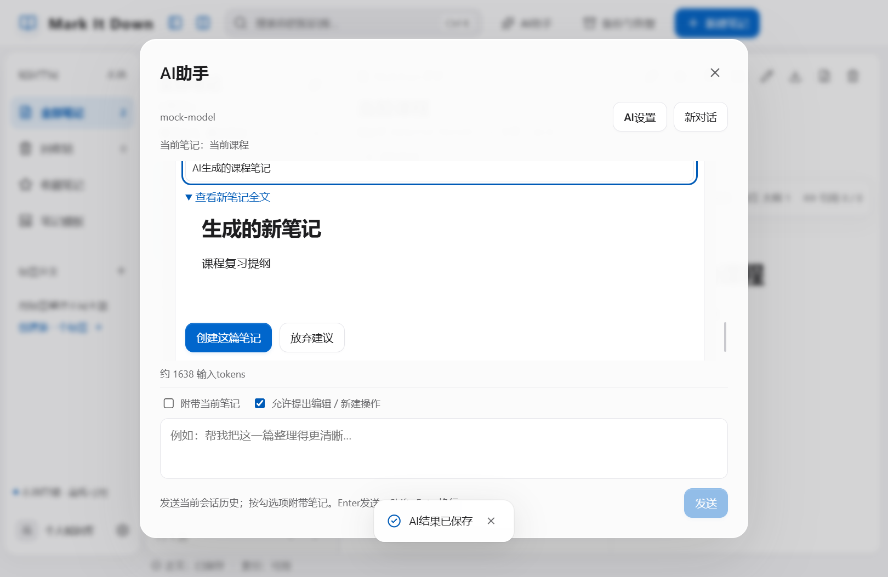

# Mark It Down1.6.0：AI聊天Agent与上下文管理

## 来源与范围

本轮来源是用户的三条连续要求：

> 能不能加入一个ai总结的功能，提供接入apikey的接口，可以ai辅助总结、生成笔记

> 我想ai助手作为一个聊天框，然后可以帮助编辑笔记，总结内容，就实现基础的agent功能就行

> 上下文管理要做好

因此最终交付为对话式笔记助手，复用原编辑、保存、容量与备份规则。原课程SRS／SDD、编号与历史验证结论保持原样，追加功能单列追踪。

## 使用方法

1. 打开“知识库设置 → AI设置”，填写API基础地址或完整Chat Completions地址、模型ID、自己的API Key，保存后可测试连接。本机无鉴权接口可留空密钥。
2. 点击顶栏“AI助手”，或者当前笔记右上角的AI图标打开聊天框。直接输入“总结这篇笔记”“润色这篇笔记，保留例题”“生成一篇学习计划”等要求。Enter发送、Shift+Enter换行，中文组合输入不作为发送操作。
3. 聊天中可持续追问。普通回答可追加到笔记或另存；Agent的编辑／新建建议展示完整正文，编辑建议同时可查看修改前全文。点击“应用修改”或“创建这篇笔记”后才写入，也可放弃建议。
4. “附带当前笔记”控制本次是否发送当前正文；不勾选时仍发送本会话对话历史。取消“允许提出编辑／新建操作”可仅聊天，适用于不支持Tools的兼容服务。停止生成或关闭聊天框会取消等待，不写入内容。

助手围绕当前笔记和会话提供的内容工作，不具备全库检索、联网检索、任意文件操作或代码执行能力。一次最多提出一个写入操作。笔记正文、引用、模板、标签、数学公式和PDF继续使用原流程。

## 连接与密钥

接口为可配置的Chat Completions HTTP接口，Agent需要服务和所选模型支持工具调用。基础地址自动补齐 `/chat/completions`；模型ID由用户按服务商说明填写，不预设某个最新模型。请求只设置必要的model、messages、stream与工具定义，不强加厂商专属推理参数。

远程地址须HTTPS，HTTP只允许localhost／127.0.0.1／IPv6本机地址；地址不得含用户名、密码、查询参数或片段。重定向不跟随。AI网络使用独立、非持久化Electron会话，省略Cookie；原渲染器的资源与导航限制继续生效。只有用户发送消息或测试连接时才请求服务。

密钥由主进程通过系统safeStorage异步加密保存，本机档案的 `ai/connection.json` 仅含加密密钥、地址、模型和上下文预算。设置读取只返回“已保存”状态，不返回密钥原值；加密不可用时拒绝保存新密钥，不退回明文。更换地址须重新填写密钥，避免自动把旧凭证发送给另一服务。清除配置可删除保存的凭证。Windows系统加密保护不等同于隔离同一系统账户下的其他程序。

AI配置与聊天历史不进入业务备份，跨设备需重新配置。用户主动保存的AI结果成为普通笔记，随原格式2备份保存。软件不记录密钥、提示全文或服务错误原文到应用日志。连接测试只发送短测试消息，不包含笔记；调用费用及服务端数据处理由用户选择的服务决定。本轮未使用真实商业密钥或真实笔记调用外部模型。

## 上下文管理

| 项目 | 最终规则 |
|---|---|
| 输入预算 | 默认估算16384 tokens，可设置4096—32768；为系统、工具与包装预留1500，用户应按实际模型窗口调整并为输出留余量 |
| 估算口径 | ASCII按约3字符／token，其他字符约1.5 tokens／码点，是本地保守估算，不是厂商精确分词或计费保证 |
| 新要求 | 始终保留本次消息，不静默截断；要求本身超过预算时明确拒绝并提示缩短或调整预算 |
| 历史选择 | 至多保留最近12条历史，按预算进一步缩减；较早对话生成有明确省略标识的目标、约束、状态与近期摘录，不另发付费摘要请求 |
| 操作状态 | 区分已应用、未应用与放弃；已应用工具的完整新正文不反复塞进历史，使用当前笔记最新快照。修订上一稿时只携带最近一份相关未应用稿 |
| 笔记上下文 | 小笔记原文发送；大笔记按消息关键词选择相关段落，并保留头尾线索，标识“笔记节选” |
| 不完整上下文 | 显示节选提示，关闭全文编辑工具；服务端再次核验，即使模型越界提出全文替换也拒绝。可以继续答疑、总结片段或建议新建 |
| 双层检查 | 发送前与主进程均按保存的预算整理上下文，服务端对权限与参数最终校验，不能由模型自行提高权限 |
| 会话生命周期 | 当前窗口内保留；关闭AI框再打开同一笔记可继续。手动换笔记重新开会话，AI创建新笔记后可延续当前对话；重启程序后历史清空，“新对话”可主动清空 |

较早内容是带省略标识的摘录汇总，不宣称完成了无损语义记忆。很早且未被摘录的细节可能不再发送；重要要求可在当前消息重申。服务实际分词与窗口可能不同，服务端仍可能拒绝长上下文。界面显示压缩数量、估算输入和节选状态，避免把未提供的内容当作完整上下文。

## Agent操作与一致性

`propose_note_edit`只提出完整新正文及修改说明；`create_note`提出标题、完整正文与说明。主进程严格校验工具名称、单次操作数量、JSON参数、标题规范与256 KiB结果上限。未知、并行或不完整的工具调用不会执行，不支持通过模型输出调用任意IPC。

应用修改前先保存原草稿，并检查资料库epoch、笔记ID、源正文与当前修订；正文已变化则保留建议并提示重试／另存。修改使用原原子保存事务，容量失败不覆盖原文。新笔记以初始正文一次事务创建，引用同步建立，失败不留下空白半成品；模板与初始正文不可混用。

一次只运行一个AI请求，120秒超时，可主动取消；不自动重试，以免重复扣费。总响应最多1 MiB，结果正文最多256 KiB。错误页、非法UTF-8、无效JSON、空回复、无效参数和超限均有提示；HTTP错误不回显可能包含密钥或提示的原始正文。取消只停止本机等待，服务端是否终止及计费以服务方为准。

## 实现追踪与验证

| 追加项 | 主要实现 | 验证 |
|---|---|---|
| AI-01连接配置 | shared/ai.ts、ai-service.ts、main.ts、AiSettings | 加密／脱敏／换地址、损坏配置、清除、实际Electron系统加密与备份排除 |
| AI-02聊天Agent | AiAssistant、受限Tools、main.ts与原note.create/save | 多轮、提议与应用、放弃、当前草稿、普通回复追加、新笔记原子创建、未知工具拒绝 |
| AI-03上下文 | shared/ai-context.ts、客户端和服务端整理 | 近期历史、早期约束、预算、相关段落、长消息不静默截断、节选禁用全文编辑 |
| AI-04异常与限制 | AbortController、边界与响应校验、原容量事务 | 取消／超时、并发、401／限流／错误正文、重定向、异常结构、容量回滚 |

最终记录见[测试与验收记录](02-测试与验收记录.md)。AI联调全部使用本机合成HTTP服务和虚拟密钥，覆盖真实IPC、网络、系统加密与数据库；不能解释为某个外部商用服务已完成实测，也不能证明模型生成内容正确。

初次AI联调被原渲染会话的网络保护阻止，失败记录保留为ai-desktop-targeted.log；改为独立AI网络会话后通过。中间总结弹窗版本的记录保留为历史开发证据，最终以聊天Agent和上下文版本为准。上下文标签调整曾使旧字面断言失败，记录另存ai-context-label-check.log，之后按新标签与原语义重新验证。

技术依据：[OpenAI Chat Completions](https://developers.openai.com/api/reference/resources/chat/subresources/completions/methods/create)、[OpenAI工具调用](https://developers.openai.com/api/docs/guides/function-calling)、[Electron系统加密](https://www.electronjs.org/docs/latest/api/safe-storage/)，查阅日期2026-11-02。

