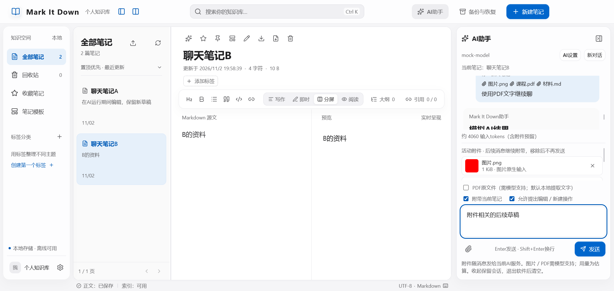
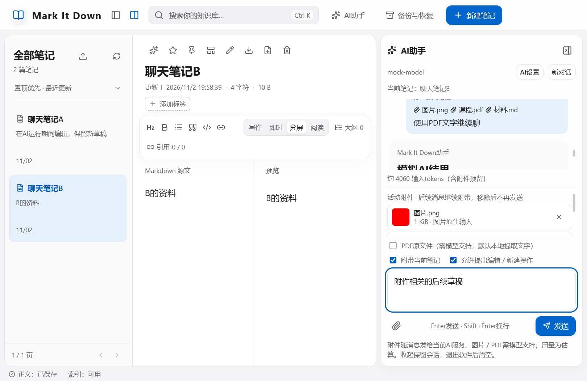

# Mark It Down 1.6.1：右侧持续聊天、Markdown导入与消息附件

## 追加要求与范围

用户要求将AI弹窗改成最右侧持续聊天区；支持拖入Markdown笔记；聊天支持图片、PDF等消息；不得把本机API配置提交GitHub，并授权用本机配置进行少量测试。本轮只扩展个人桌面软件，原课程SRS／SDD基线、业务数据库与格式2备份保持原样。

## 右侧聊天

- 顶栏“AI助手”展开／收起右侧面板。面板与编辑区并排，可以边写边聊，没有模态遮罩。
- 收起只是隐藏：消息、未发送草稿、活动附件和正在等待的请求继续保留；重新展开可接着聊。停止请求使用“停止生成”，新会话使用“新对话”。退出软件后会话清空，不写聊天历史到磁盘。
- 切换笔记继续同一会话，“当前笔记”随选择更新；发送时记录笔记快照，历史标出当时的笔记标题。旧建议仍针对原快照，原文、笔记或资料库已变化时拒绝覆盖。
- 1080宽窗口打开聊天时暂时只显示导航／列表之一，默认显示列表，为正文保留至少420px；顶栏按钮可切换。收起聊天恢复原三栏布局偏好。1480宽窗口可并排显示导航、列表、正文与聊天。工具条自动换行。
- 正文持久化与索引状态仍分开显示，AI写入仍须预览并明确应用。

## Markdown导入

将`.md`／`.markdown`文件拖到主工作区，或点击笔记列表标题旁“导入Markdown”。拖到聊天区则添加为聊天附件，不创建笔记。

| 项目 | 规则 |
|---|---|
| 批量限制 | 每次最多50个文件；单文件1 MiB，每批原文件及解码正文各不超过10 MiB，仍受全库容量约束 |
| 文字编码 | UTF-8（含BOM）、带BOM的UTF-16LE／BE；无效编码和二进制拒绝，不用替换字符冒充成功 |
| 标题 | 来自文件名，去扩展名，方括号／控制字符等替换为空格，最多100码点；空标题使用“导入笔记” |
| 同名 | NFC／ASCII键按现有规则比较，自动添加` (1)`、` (2)`等后缀；绝不覆盖现有笔记 |
| 事务 | 先校验全部文件、保存当前草稿，再一次业务事务导入；失败整批回滚，包括引用激活与容量检查；请求收据防止重复提交 |
| 保留内容 | 原正文、CRLF、公式、代码、正文中的front matter均按文字保留；不把front matter转换成标签等元数据 |
| 边界 | 不遍历文件夹，不导入相对图片、附件、标签、收藏、模板等元数据，不改动磁盘原文件，不重写正文中的引用名称；重名编号后原引用仍按原名称解析 |

导入结果自动打开最后一篇，并显示数量；原有效笔记和草稿保留。导入是用户明确追加范围，不改写早期“不含Markdown导入”的课程基线。

## 聊天附件

点击输入框旁回形针、拖到聊天面板，或粘贴图片。支持PNG／JPEG／WebP、PDF、Markdown、TXT、CSV、JSON；暂不支持Word、Excel、音视频和文件夹。

每个会话最多5个活动附件、共20 MiB，每个最多8 MiB；文字文件另限128 KiB。添加前全部校验，读入失败保留原附件。聊天气泡仅保存附件信息，不把相同二进制复制到每条历史消息中。

活动附件默认随后续消息继续发送，列表明确提示；点击附件旁移除后不再发送原内容，历史文件名只作来源记录。添加附件本身不请求外部服务，发送／测试连接才请求服务。附件不写入笔记库、备份或GitHub；AI生成的内容只有用户应用／另存后才成为笔记。

| 类型 | 输入与兼容规则 |
|---|---|
| 图片 | 内联`image_url`，需要当前服务／模型支持图片；不使用任意本机路径或远程图片URL |
| PDF默认 | 打包的PDF.js在本地专用Worker提取文字，发送文字而非原文件；最多100页／约100 KiB提取文字，超限明确标为节选，不包含图表、扫描图或版式 |
| PDF原文件 | 勾选“PDF原文件”后按Chat Completions `file`发送；服务／模型须支持，失败不会悄悄切换或再次扣费重试 |
| 无文字PDF | 提示使用原文件模式或转成图片；不能把扫描件当作已读全文。加密PDF须先解密，损坏或超时明确报错 |
| 文字 | 原文作为参考资料，按上下文预算显式节选；不执行JSON、脚本、表格公式或资料中的命令 |

图片预留2048估算tokens／个，PDF原文件预留4096／个，文字资料另分配预算。它们不是厂商精确分词，PDF页数、图片分辨率与实际窗口仍可能导致服务拒绝；不足时要求移除附件或调整预算，不静默丢弃附件。笔记被节选时仍禁用全文替换工具。可取消工具操作选项以使用不支持Tools的服务。

## 密钥保护与实际验证

模拟测试全部使用临时资料库、合成附件与虚拟密钥。真实兼容测试只在临时目录复制系统加密配置及所需系统加密状态，不读取个人笔记；完成后移除临时凭证文件并验证原配置摘要不变。报告仅保留通过标志与固定错误类别，没有密钥、地址、模型配置或模型原始响应。

2026-11-02少量真实请求结果：连接成功、合成图片请求成功；PDF原文件被当前服务拒绝；改用默认的本地提取文字后，模型正确返回合成PDF中的验证数字。该记录只证明所测配置与合成样例可用，不外推所有模型、PDF或识别准确率。见[兼容结果](../reports/real-service-compatibility.json)、[原文件失败结果](../reports/real-service-native-pdf.json)。

| 追踪项 | 实现 | 验证 |
|---|---|---|
| AI-05持续聊天侧栏 | renderer/main.tsx、ai.tsx、pane-layout.tsx、ai.css | 无遮罩并行编辑，收起／重开草稿，在途请求完成，跨笔记延续，1480／1080布局与原偏好恢复 |
| IMP-01文件导入 | shared/files.ts、renderer/main.tsx、backend/service.ts／store.ts、preload.ts | 编码、标题、重复编号、幂等、原文保留、提交失败／联动超限整批回滚、真实拖放／重启 |
| AI-06消息附件 | renderer/file-input.ts／pdf-input.ts、shared/files.ts／ai-context.ts、attachments.ts、ai-service.ts | 选择／拖放与导入分流、延迟发送、移除、原生结构、PDF文字、节选／预算、原文保护 |
| SEC-追加密钥保护 | 本机加密、隔离测试、忽略规则、交付白名单 | 配置不进入业务备份／版本控制，发布前检查文件与档案内容 |

最终全量结果见[测试与验收记录](02-测试与验收记录.md)。手工外部程序拖放、多种实际扫描件、极端PDF／全输入法和长期运行仍未穷尽验证。

技术依据：[OpenAI文件输入](https://developers.openai.com/api/docs/guides/file-inputs)、[图片输入](https://developers.openai.com/api/docs/guides/images-vision)、[Mozilla PDF.js](https://mozilla.github.io/pdf.js/examples/)，查阅日期2026-11-02。

